# enterprise-flight

Two and a half minutes in one take, flown by the ship's autopilot: the inner gorge of a canyon on the Earth-like world, the climb out through the clouds, a moment in low orbit, warp 9.9 across 2.9 billion km to Caerulea I with its ringed ice giant standing over the lineae, full impulse into the Caerulea Nebula, and warp back to the night side of Starbase 11 with its windows lit.

A flyable, life-size Star Trek solar system in Unreal Engine 5.8. You fly a kinematic Enterprise with impulse and warp drive through a procedurally generated star system at real scale, with its three nearest real neighbours a transwarp leg away: planets with terrain, atmospheres, clouds and rings, an asteroid belt, spinning space stations, patrolling starships that warp between them, a Borg cube, and combat with shields, phasers, torpedoes and a tractor beam. A floating origin keeps AU-scale distances precise, the Star Trek VI bridge set gives a first-person view from the captain's chair, and warp can be watched as the physics says it would look: aberration, Doppler shift and the multiple images of other ships seen through their own light.

The project lives in `unreal/` (open `Slonk.uproject` in UE 5.8, build the `SlonkEditor` target, open the `SpaceTest` map and press Play; the Unreal project and module keep their original working name, Slonk). C++ is in `unreal/Source/Slonk`; materials and the map are generated assets under `unreal/Content/Slonk`. The clips below are animated WebP files in `docs/media`, captured in play.

## Scale

The system is real size. Planets are thousands of kilometres across, orbits are tenths of an AU to tens of AU apart, and the ship is 305 m long, so nothing is faked with a skybox: the planet behind the station below really is 23,000 km away. Full impulse is a quarter of the speed of light, with a throttle curve that still gives km/s precision near a station.

Looking aft from beside Starbase 11: a slow drift past the station, then full impulse. The station is gone in a blink and the Earth-like world behind it shrinks to a coin in ten seconds.

## Warp, the relativistic view

Alongside the classic streak-and-flash, the ship has a view of faster-than-light travel rendered as the physics says it would look: aberration crowds the whole sky toward the bow and empties the sky astern, the Doppler shift blues what is ahead and reddens what is behind, and other ships at warp are seen through their own light, which means several of them at once. It is a post-process on the real frame (switch with `warpvis real`), so planets, stations, the sun and other ships all go through it, and the effects below are not canned animations but what the camera sees of the live scene.

Our own jump to warp 2 beside the Earth-like world, chase camera: the planet is gone in the flash, the star field crowds toward the bow and blue-shifts, and the sun slides in from the edge of the view:

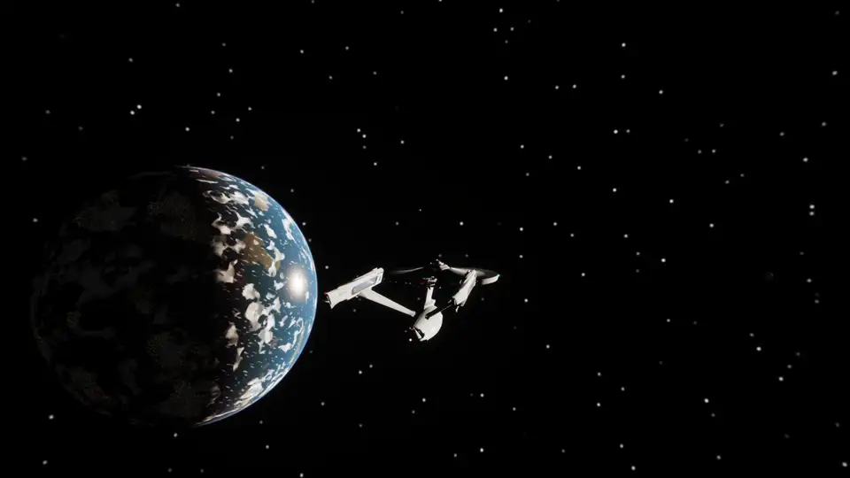

Warp 1, 1.5, 2 and 2.5 with the sun 70° off the bow, out of the frame to starboard. Aberration carries it into view and toward the bow a step at a time, the shift whitens it, and by warp 2.5 almost the whole sky is in the forward hemisphere:

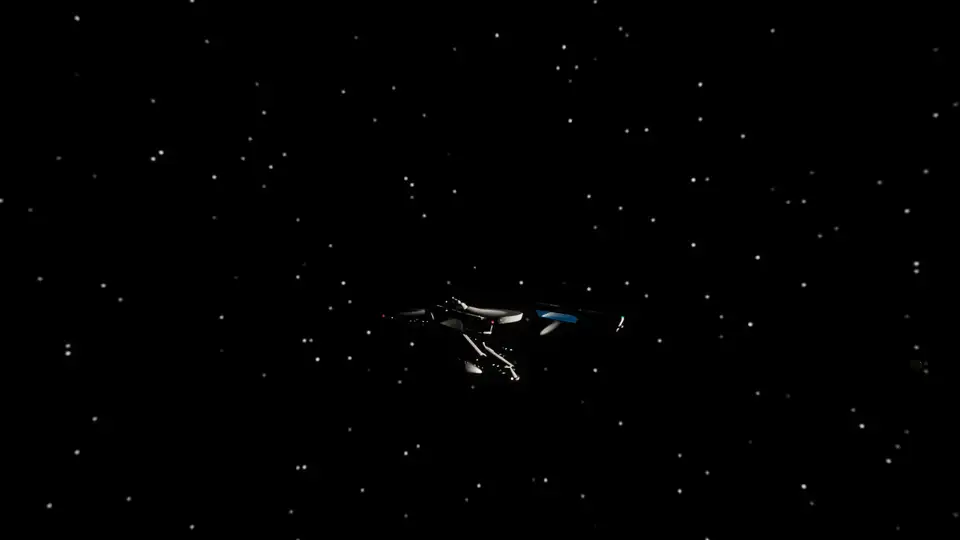

Dropping out of warp at the ringed ice giant, flown by the autopilot. At warp the giant ahead is a crushed, brightened blue blob among the crowded stars; at the drop the sky relaxes outward and the giant is there with its rings and two moons, forty thousand kilometres off, with the edge of the nebula beyond it filling the left of the view:

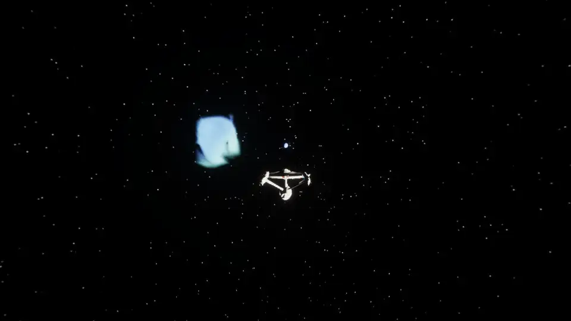

The same jump from the captain's chair, the sun coming onto the viewscreen as the ship works up to warp 2:

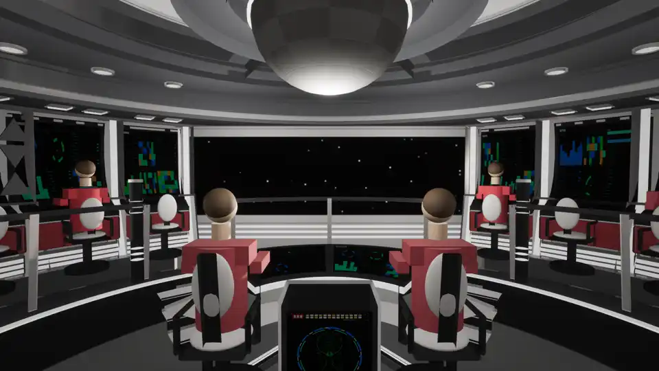

Other ships at warp are drawn where their light is, with the visual light speed scaled down (`cscale`) so the sweeps span seconds instead of microseconds. Light from the point of the track nearest you arrives first, and the images then run outward along the track in both directions from that point. Head-on arrival: the ship pops into view at its arrival point first, and an after-image then runs backward up the track, red-shifted and shrinking, until it replaces the old pre-departure image:

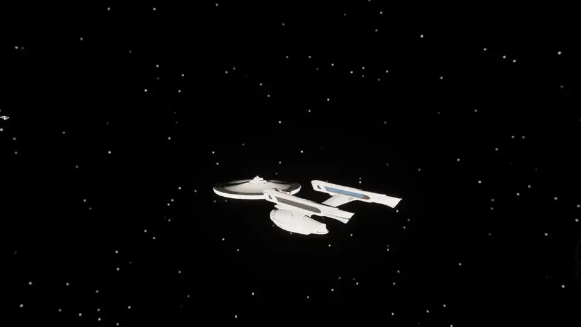

Across the bow: a ship nine kilometres to port warps to a point ahead and the track crosses the view. The ship is seen at the destination before its old image at the departure point has gone, and a red-shifted copy runs back along the track to meet it:

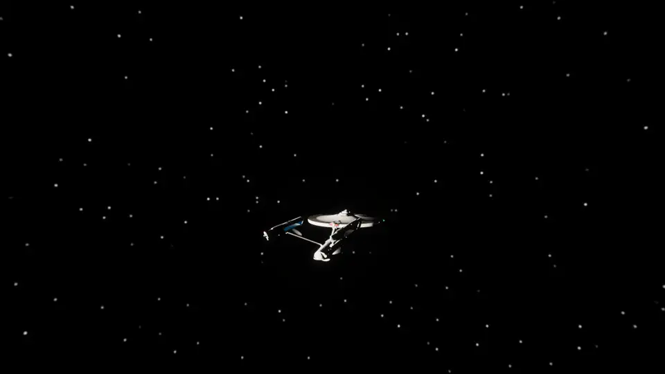

Departure from alongside: the live ship is gone in a blink, the image of it before departure stays where it was, then runs up the track after it, red-shifted and dimming:

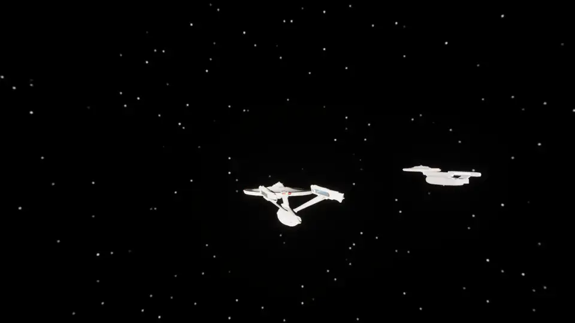

 

## Impulse and warp

Warp speed follows the show's curve (warp 1 is light speed, warp 3 is 39 c), so a hop between orbits takes seconds and crossing the system takes a minute. Two warp looks are built in, switched with `warpvis classic` and `warpvis real`: the relativistic view above, and the classic streak-and-flash below.

## Star systems

The Sun's three nearest real neighbours are in the sky at their true bearings and distances: Alpha Centauri (a yellow star, 4.37 light-years), Barnard's Star (a red dwarf, 5.96) and Sirius (a white star, 8.6). Each is a full system generated from a seed at play start: a star of its spectral class, four to seven planets placed by temperature band (lava and Venus-like worlds inside, Earth-like and ocean worlds in the temperate zone, giants and ice worlds beyond), rings and moons where the giants roll them, a belt in two systems out of three, a station with patrol ships at every planet, and a nebula past each ringed giant. Every body of a system hangs from one anchor, so the floating origin moves a system as a unit and a world keeps its exact place after a light-year crossing.

Getting there is a transwarp leg. Below warp 9.9 the drive follows the show's curve; above it the curve climbs toward the warp 10 asymptote, and warp 9.99 crosses a light-year in about fifteen seconds. `systems` lists the systems with their distances, `nav target Sirius` and `autopilot warp` fly there, and the HUD reads distances in light-years. The neighbouring suns are visible from home as points of their own colour, and on arrival the sunlight, the sky and the horizon hand-overs all belong to the new star.

## Planets

Every world is generated at real scale from a seed. The height field is computed in double precision on the CPU in two stages, the way Outerra layers fractal detail over its elevation data: a structure stage (domain-warped continents, ridged mountain ranges, canyons cut into uplifted tablelands with fluted, stratified walls and a river down the inner gorge, craters on the airless worlds) down to 200 m, and a refinement stage that synthesises what lies below it from the structure's local slope (fractured rock on cliffs, talus and boulders beneath them, hummocky soil on the flats) down to 25 cm. Both are deterministic functions of position, so nothing is stored and every visit is the same place. The surface is drawn through a cube-sphere quadtree of mesh chunks that splits toward the camera from six root chunks in orbit down to those 25 cm cells on the ground, so the same surface serves the view from space and a flight along a canyon floor. The sea is part of the same mesh at the water level: within a few kilometres its vertices ride a swell of four Gerstner waves (real geometry, so the horizon and the ship's shadow move with it), and on top of that it is shaded with baked wind waves at two scales that scroll with time and fade out by twenty kilometres so the sun glint from orbit stays sharp, sand showing through the first metres, foam along the shore and on the crests. Atmospheres are volumetric with real scale heights, and near a planet its clouds are a volumetric layer whose height, thickness, density, continuity and colour come from the world's style (cumulus from 2 to 10 km on an Earth-like world, the sulphuric deck from 48 to 70 km on a Venus, thin ice wisps on a Mars, a continuous haze on a Titan-like moon) and that throws its shadows across the ground; the textured cloud shell, now at the top of that layer, takes over from orbit; planets turn at real day lengths, relief is in real proportion, and the gas giants keep a shader-shaded sphere with cloud bands and rings. Orbit hold keeps a chosen altitude while you look around; `hover <m>` follows the terrain (`hover <m> canyon` also steers along the canyon), and `terrain goto river 200 along` parks the ship over the river in the deepest canyon of the nearest world, nose along it.

Down the inner gorge of a canyon on the Earth-like world at 250 m/s, 150 m above the floor. The walls are a stack of strata of hashed thickness and hardness: hard layers stand as cliffs, soft ones slump into scree, and each bench wanders along the canyon on its own. Side canyons cut into the walls every few kilometres from a second, denser line field held to the ones that run into the trunk rather than along it; each reaches a varying distance into the plateau and ends in an amphitheatre where its floor climbs back through the strata. The ground is dressed with four tileable texture sets (bedded cliff, talus, desert soil, scrub) baked in Blender from procedural shaders on a 4-D torus so they wrap, packed to colour + height and normal + occlusion + roughness, and chosen per pixel by slope, rock and moisture. They are laid down in 20 m hashed cells of a planet-local lattice, each with its own heading in a frame tied to the ground and projected triplanar within it, so 5 m tiles never line up into a quilt and the beds stay horizontal on the cliffs; the sets modulate the procedural colour rather than replace it. `tools/planet_materials/bake_terrain_textures.py` bakes them and `import_terrain_textures.py` imports them headless.

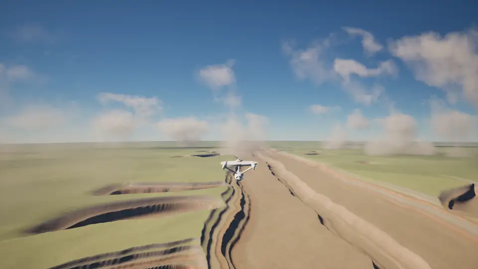

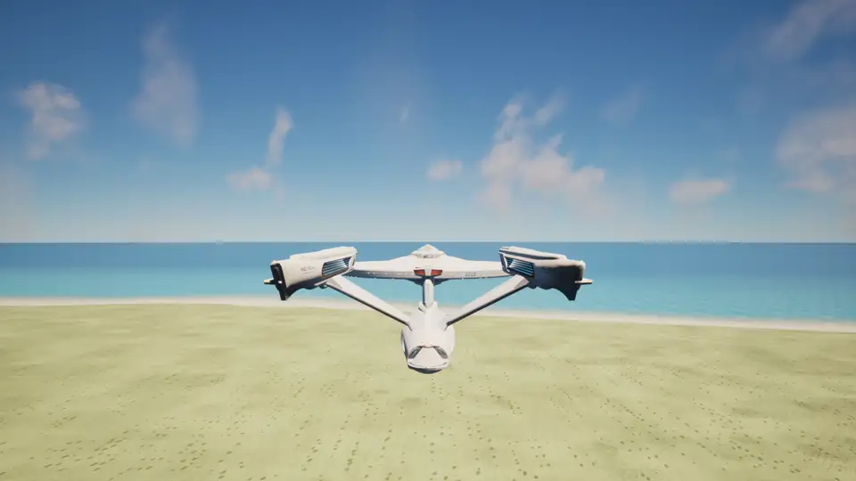

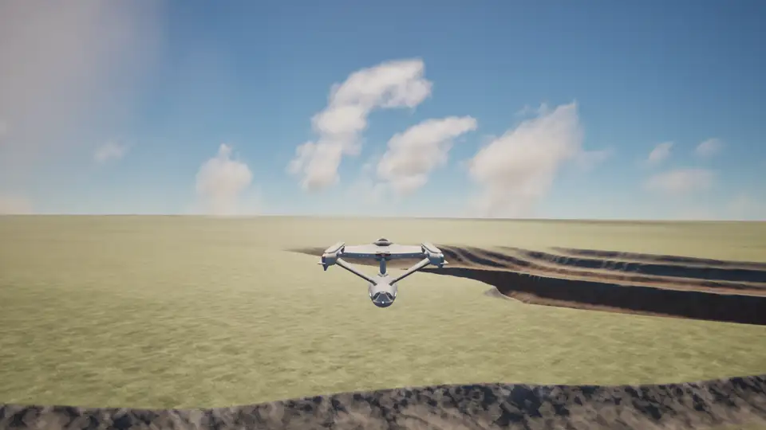

 
 
 

## Moons

Every ringed giant has an icy moon the size of Europa just outside its rings and a hazy moon the size of Titan further out. The icy moons carry lineae, long double-ridged cracks in the crust stained brown along their floors; the hazy moons keep an orange photochemical haze from 30 to 90 km that turns the sky from below. `terrain goto linea 300 giant` lands on a crack facing the giant.

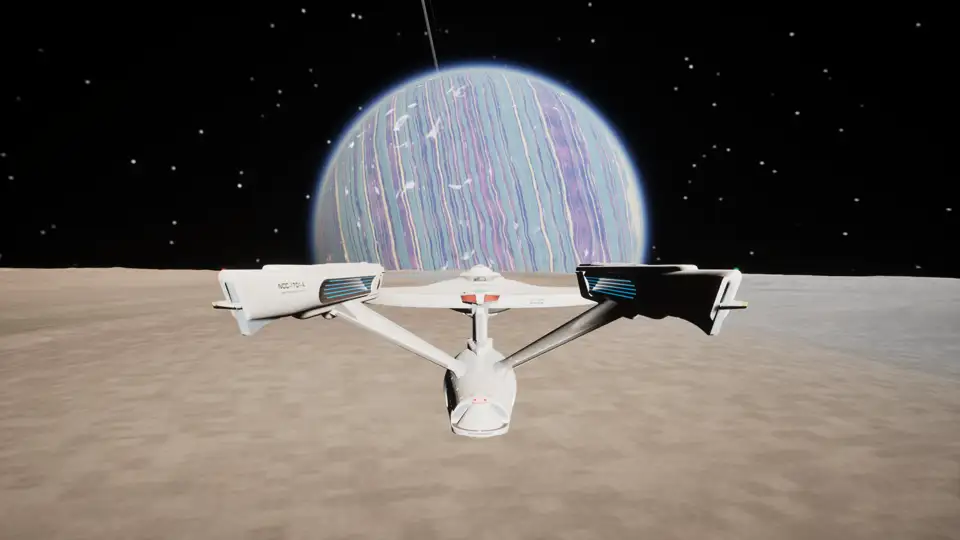

 

## Nebulae

A nebula is a sphere of gas the ship can fly into: the material ray-marches it from the camera to the far side or the first thing in the way, through domain-warped noise that thins toward a ragged edge, scattering the star's light and the gas's own glow, and the transmittance left over veils whatever lies behind. One a light-second across lies beyond each ringed giant; the nav list knows them.

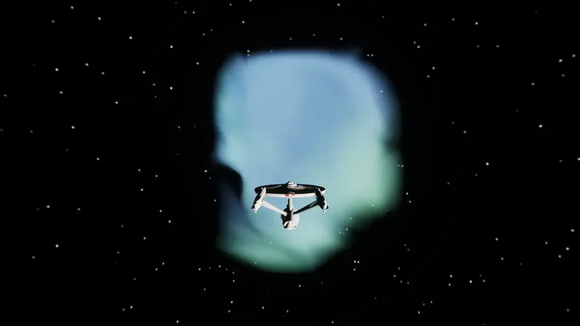

 

## Ships and stations

Every station orbits a planet and every planet has traffic: Constitution, Miranda and Excelsior class ships patrol between stations and warp when they leave. Hulls carry running lights, floodlights and rows of lit windows that show through on the dark side; stations have hub and ring windows, a strobe chase and beacons.

 

## Combat

Phasers, photon torpedoes, shields with a visible bubble, hull damage, a tractor beam and a Borg cube that shoots back. Lock the nearest target and fire; the HUD tracks shields and hull.

## The bridge

The Star Trek VI bridge is built from code in Blender (`blender/bridge-st6`) and imported as one mesh with its Okudagram screens bound to live readouts. From the captain's chair the viewscreen shows the real view ahead; the crew figures are placeholders for now.

## Credits

The Enterprise hull flown in the space test is the one paid asset in the project: "U.S.S. Enterprise NCC-1701-A" (https://skfb.ly/6RsXJ) by Major Stress is licensed under Creative Commons Attribution (http://creativecommons.org/licenses/by/4.0/). Everything else is generated by the project's own scripts and code.

The Star Trek VI bridge set in `blender/bridge-st6` was modelled from scratch using Donny Versiga's renders of the 2293 Enterprise-A bridge as reference, view for view (https://www.artstation.com/artwork/YeNkG3). None of his files are used; his work set the layout, proportions and look that the set is measured against. Thank you, Donny.
