# enterprise-flight

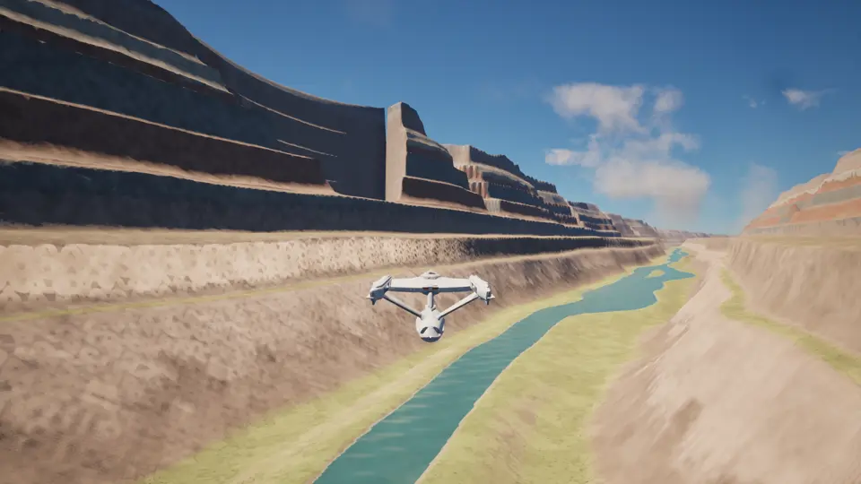

Two and a half minutes in one take, flown by the ship's autopilot: the inner gorge of a canyon on the Earth-like world, the climb out through the clouds, a moment in low orbit, warp 9.9 across 2.9 billion km to Caerulea I with its ringed ice giant standing over the lineae, full impulse into the Caerulea Nebula, and warp back to the night side of Starbase 11 with its windows lit.

A flyable, life-size Star Trek solar system in Unreal Engine 5.8. You fly a kinematic Enterprise with impulse and warp drive through a procedurally generated star system at real scale, with its three nearest real neighbours a transwarp leg away: planets with terrain, atmospheres, clouds and rings, an asteroid belt, spinning space stations, patrolling starships that warp between them, a Borg cube, and combat with shields, phasers, torpedoes and a tractor beam. A floating origin keeps AU-scale distances precise, the Star Trek VI bridge set gives a first-person view from the captain's chair, and warp can be watched as the physics says it would look: aberration, Doppler shift and the multiple images of other ships seen through their own light.

The project lives in `unreal/` (open `Slonk.uproject` in UE 5.8, build the `SlonkEditor` target, open the `SpaceTest` map and press Play; the Unreal project and module keep their original working name, Slonk). C++ is in `unreal/Source/Slonk`; materials and the map are generated assets under `unreal/Content/Slonk`. The highlight is an animated WebP in `docs/media`; the clips below are 1080p videos hosted as GitHub attachments, all captured in play.

## Scale

The system is real size. Planets are thousands of kilometres across, orbits are tenths of an AU to tens of AU apart, and the ship is 305 m long, so nothing is faked with a skybox: the planet behind the station below really is 23,000 km away. Full impulse is a quarter of the speed of light, with a throttle curve that still gives km/s precision near a station.

https://github.com/user-attachments/assets/96eae552-1a59-4d7b-ac8a-1a73c8f5f434

https://github.com/user-attachments/assets/c0b3dcb8-a531-453d-9af0-8e594d3b8e7c

Looking aft from beside Starbase 11: a slow drift past the station, then full impulse. The station is gone in a blink and the Earth-like world behind it shrinks to a coin in ten seconds.

## Warp, the relativistic view

Alongside the classic streak-and-flash, the ship has a view of faster-than-light travel rendered as the physics says it would look: aberration crowds the whole sky toward the bow and empties the sky astern, the Doppler shift blues what is ahead and reddens what is behind, and other ships at warp are seen through their own light, which means several of them at once. It is a post-process on the real frame (U switches, or `ship warpvis real` in the console), so planets, stations, the sun and other ships all go through it, and the effects below are not canned animations but what the camera sees of the live scene.

Our own jump to warp 2 beside the Earth-like world, chase camera: the planet is gone in the flash, the star field crowds toward the bow and blue-shifts, and the sun slides in from the edge of the view:

https://github.com/user-attachments/assets/1738271c-bc6a-420f-ac5a-80bc6b9d363a

Warp 1, 1.5, 2 and 2.5 with the sun 70° off the bow, out of the frame to starboard. Aberration carries it into view and toward the bow a step at a time, the shift whitens it, and by warp 2.5 almost the whole sky is in the forward hemisphere:

https://github.com/user-attachments/assets/3bc08613-48fd-4179-9288-74d31f00863b

Dropping out of warp at the ringed ice giant, flown by the autopilot. At warp the giant ahead is a crushed, brightened blue blob among the crowded stars; at the drop the sky relaxes outward and the giant is there with its rings and two moons, forty thousand kilometres off, with the edge of the nebula beyond it filling the left of the view:

https://github.com/user-attachments/assets/22a90b0a-2f92-49e9-901d-b05951614d72

The same jump from the captain's chair, the sun coming onto the viewscreen as the ship works up to warp 2:

https://github.com/user-attachments/assets/d4212a68-c7ba-4f40-9a71-c494fa83895e

Transwarp, above warp 9.9, is a thousand times faster again and the view says so. The aberration clamp rises from warp 9.9's ring of stars to a knot ahead of the bow, and the Doppler shift runs off the ends of the visible band: what is ahead goes violet and then ultraviolet-black, what is behind goes red and then fades to nothing, and the beamed light ahead collapses into a violet halo with a white core. The run-up from warp 5 to 9.99, chase camera:

https://github.com/user-attachments/assets/4c279b67-d5eb-4a97-a27a-04332f1b8c9b

Other ships at warp are drawn where their light is, with the visual light speed scaled down (`ship cscale`) so the sweeps span seconds instead of microseconds. Light from the point of the track nearest you arrives first, and the images then run outward along the track in both directions from that point. Head-on arrival: the ship pops into view at its arrival point first, and an after-image then runs backward up the track, red-shifted and shrinking, until it replaces the old pre-departure image:

https://github.com/user-attachments/assets/090eb0fe-ecf2-4f09-8250-cb81ca560c56

Across the bow: a ship nine kilometres to port warps to a point ahead and the track crosses the view. The ship is seen at the destination before its old image at the departure point has gone, and a red-shifted copy runs back along the track to meet it:

https://github.com/user-attachments/assets/5243ab51-0288-4dac-94b7-830d4300cf68

Departure from alongside: the live ship is gone in a blink, the image of it before departure stays where it was, then runs up the track after it, red-shifted and dimming:

https://github.com/user-attachments/assets/7803ede5-cecd-4408-b4d0-a2e8efa686b4

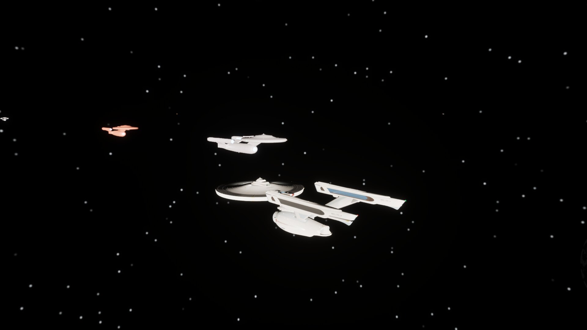 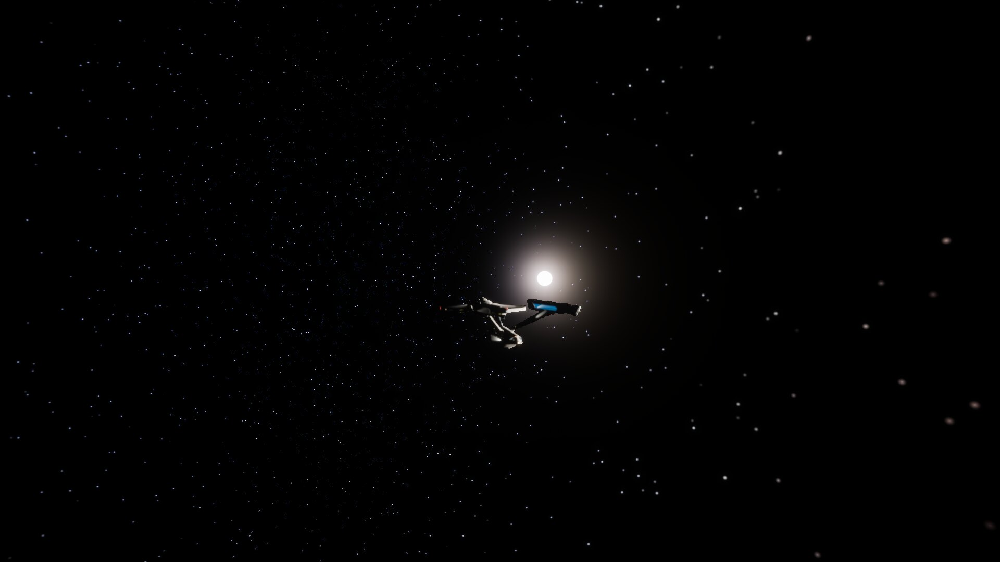

## Impulse and warp

Warp speed follows the show's curve (warp 1 is light speed, warp 3 is 39 c), so a hop between orbits takes seconds and crossing the system takes a minute. Two warp looks are built in, switched with U (or `ship warpvis classic` and `ship warpvis real` in the console): the relativistic view above, and the classic streak-and-flash below.

https://github.com/user-attachments/assets/77f7650e-2cd8-475f-9d0e-addd550871f8

In the classic view transwarp has a look of its own too: the streaks take cycling rainbow hues and run longer and faster, the radial blur splits into a prism along every streak, and a prismatic ring sweeps out from the vanishing point. The same run-up from warp 5 to 9.99:

https://github.com/user-attachments/assets/d1a76720-41e4-4bc3-ae41-177799456d21

## Star systems

The Sun's three nearest real neighbours are in the sky at their true bearings and distances: Alpha Centauri (a yellow star with an orange companion 23 AU out, 4.37 light-years), Barnard's Star (a red dwarf, 5.96) and Sirius (a white star with a white-dwarf companion 20 AU out, 8.6). Each is a full system generated from a seed at play start: a star of its spectral class, four to seven planets placed by temperature band (lava and Venus-like worlds inside, Earth-like and ocean worlds in the temperate zone, giants and ice worlds beyond), a companion star with a few worlds of its own where there is one, rings and moons where the giants roll them, a belt in two systems out of three, a station with patrol ships at every planet, and a nebula past each ringed giant. Every body of a system hangs from one anchor, so the floating origin moves a system as a unit and a world keeps its exact place after a light-year crossing.

Getting there is a transwarp leg. Below warp 9.9 the drive follows the show's curve; above it the curve climbs toward the warp 10 asymptote, and warp 9.99 crosses a light-year in about fifteen seconds. In the console `ship systems` lists the systems with their distances, `ship nav target Sirius` picks one (or I filters the nav list to stars and L cycles to it) and P hands the leg to the autopilot, and the HUD reads distances in light-years. The neighbouring suns are visible from home as points of their own colour, and on arrival the sunlight, the sky and the horizon hand-overs all belong to the new star.

The leg to Alpha Centauri, flown by the autopilot: the jump beside the Earth-like world and the transwarp streaks, then the drop ten AU out with the two suns ahead:

https://github.com/user-attachments/assets/d3d34352-bdb5-4363-a01e-ef90f61cbeea

On to Alpha Centauri IV, the system's Earth-like world, its twin suns in the sky:

https://github.com/user-attachments/assets/1217dacf-b4f1-4b20-89b8-4c7c6707035b

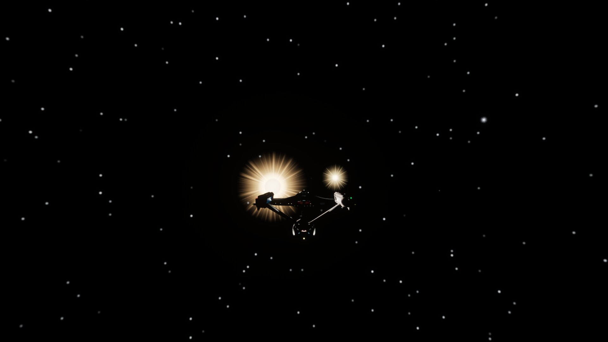

## Planets

Every world is generated at real scale from a seed. The height field is computed in double precision on the CPU in two stages, the way Outerra layers fractal detail over its elevation data: a structure stage (domain-warped continents, ridged mountain ranges, canyons cut into uplifted tablelands with fluted, stratified walls and a river down the inner gorge, craters on the airless worlds) down to 200 m, and a refinement stage that synthesises what lies below it from the structure's local slope (fractured rock on cliffs, talus and boulders beneath them, hummocky soil on the flats) down to 25 cm. Both are deterministic functions of position, so nothing is stored and every visit is the same place. The surface is drawn through a cube-sphere quadtree of mesh chunks that splits toward the camera from six root chunks in orbit down to those 25 cm cells on the ground, so the same surface serves the view from space and a flight along a canyon floor. The sea is part of the same mesh at the water level: within a few kilometres its vertices ride a swell of four Gerstner waves (real geometry, so the horizon and the ship's shadow move with it), and on top of that it is shaded with baked wind waves at two scales that scroll with time and fade out by twenty kilometres so the sun glint from orbit stays sharp, sand showing through the first metres, foam along the shore and on the crests. Atmospheres are volumetric with real scale heights, and near a planet its clouds are a volumetric layer whose height, thickness, density, continuity and colour come from the world's style (cumulus from 2 to 10 km on an Earth-like world, the sulphuric deck from 48 to 70 km on a Venus, thin ice wisps on a Mars, a continuous haze on a Titan-like moon) and that throws its shadows across the ground; the textured cloud shell, now at the top of that layer, takes over from orbit; planets turn at real day lengths, relief is in real proportion, and the gas and ice giants have no ground at all: the banded sphere is their ten-bar deck, under a hydrogen sky with a real scale height and a volumetric cloud layer whose zones, belts and storm ovals come from a zonal weather map, white tops over deeper rust and cream, or a few methane streaks over an ice giant's blue haze. There is nothing to land on; below a few tens of kilometres above the deck the pressure climbs past what the hull takes, the HUD reads it in bar, and the airlock stays shut. The home system has a Jovian giant with showcase moons as well as the ringed ice giant Caerulea. Worlds with night lights have settlements to match: the same nested point fields that light the terrain at night (25 km regions, 6 km clusters, 1.6 km towns on low, wet, level land) place cities at the cluster points and towns between them as you come within thirty kilometres: blocks, tiered towers and pitched-roof houses on a street grid with avenues every few rows, towers at the heart of a city and a landing pad with a lit ring, houses at the edge of a town, their windows lit after dark, the streets and lots paved on the terrain by day and the streets lit at night, roads running between neighbouring settlements, and with collision for the shuttle and for the crew on foot, who can walk the streets and stand on the roofs; `ship terrain goto city` finds the biggest one within six hundred kilometres. Orbit hold keeps a chosen altitude while you look around; `ship hover <m>` follows the terrain (`ship hover <m> canyon` also steers along the canyon), and `ship terrain goto river 200 along` parks the ship over the river in the deepest canyon of the nearest world, nose along it.

https://github.com/user-attachments/assets/36df6d62-e5e1-4171-9d36-a8f8467c0d71

https://github.com/user-attachments/assets/1dfca947-af25-40f8-b6fa-7b444f17250c

Down the inner gorge of a canyon on the Earth-like world at 250 m/s, 150 m above the floor. The walls are a stack of strata of hashed thickness and hardness: hard layers stand as cliffs, soft ones slump into scree, and each bench wanders along the canyon on its own. Side canyons cut into the walls every few kilometres from a second, denser line field held to the ones that run into the trunk rather than along it; each reaches a varying distance into the plateau and ends in an amphitheatre where its floor climbs back through the strata. The ground is dressed with four tileable texture sets (bedded cliff, talus, desert soil, scrub) baked in Blender from procedural shaders on a 4-D torus so they wrap, packed to colour + height and normal + occlusion + roughness, and chosen per pixel by slope, rock and moisture. They are laid down in 20 m hashed cells of a planet-local lattice, each with its own heading in a frame tied to the ground and projected triplanar within it, so 5 m tiles never line up into a quilt and the beds stay horizontal on the cliffs; the sets modulate the procedural colour rather than replace it. `tools/planet_materials/bake_terrain_textures.py` bakes them and `import_terrain_textures.py` imports them headless.

https://github.com/user-attachments/assets/b5fc52da-83d4-46f8-b1a1-9e7d6caee3a4

https://github.com/user-attachments/assets/9fcfa463-ebdb-42cd-8770-73718401e19d

https://github.com/user-attachments/assets/49ab1990-8066-4a10-9c2d-077e42233f7e

The clouds are two things that hand over to each other. Near a world the sky overhead is a ray-marched volumetric layer, placed by the world's kind (cumulus from a couple of kilometres up on an Earth-like world, a marine deck on an ocean world, Mars's wisps at ten, Venus's acid deck at fifty) and then lifted by the height of the land under it, read from the height field, so the base clears the plateaus and the shuttle's landing grounds rather than sitting on them. Where the clouds are comes from a weather map made for each world as you approach it, an equirectangular field over the sphere with the continent-scale masses drawn into east-west fronts, the hundred-kilometre cells that break a deck up, and the cloud type by region, so from orbit the layer is masses and lanes of clear air rather than one pattern tiled to the horizon, and the sky overhead can be overcast or clear by where you land. The layer is drawn out to about nine hundred kilometres up; across the next six hundred it thins as the planet's cloud shell comes in, and the shell reads the same map through the same coverage formula, lit by the sun through that atmosphere so it reddens and dies away across the terminator as the layer does, so the masses you flew under are the ones you see from orbit. Weather drifts over the ground at a jet-stream pace. Climbing out, the sky darkens with the air above you, the stars come through across the middle of the daylight range, and the sky light fades with altitude so the night side is dark from orbit.

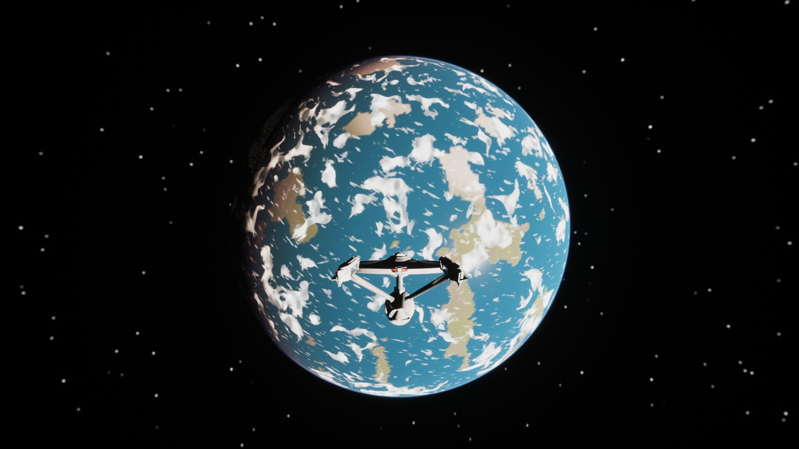 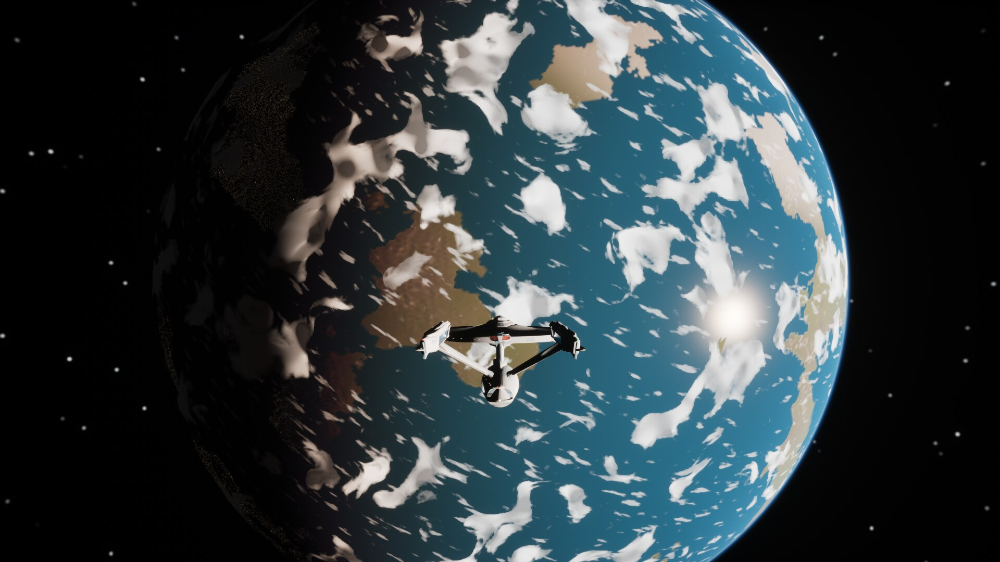
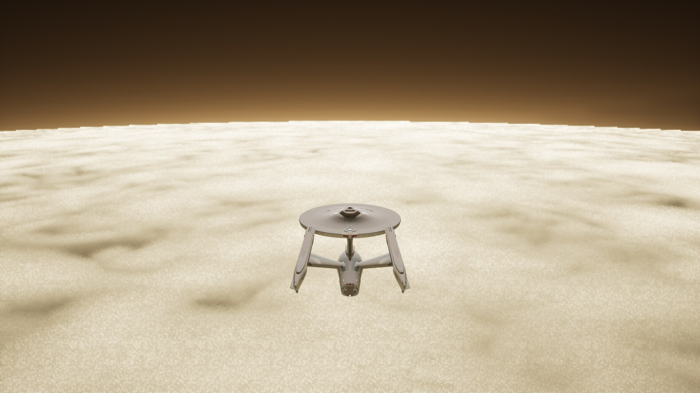 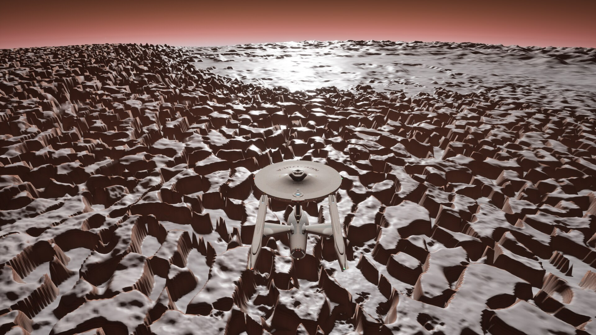
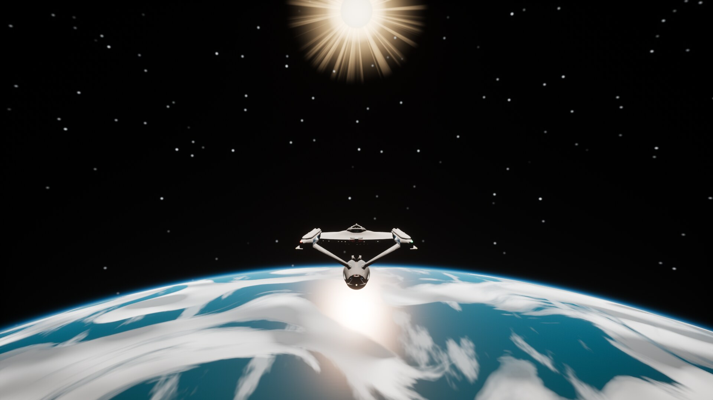 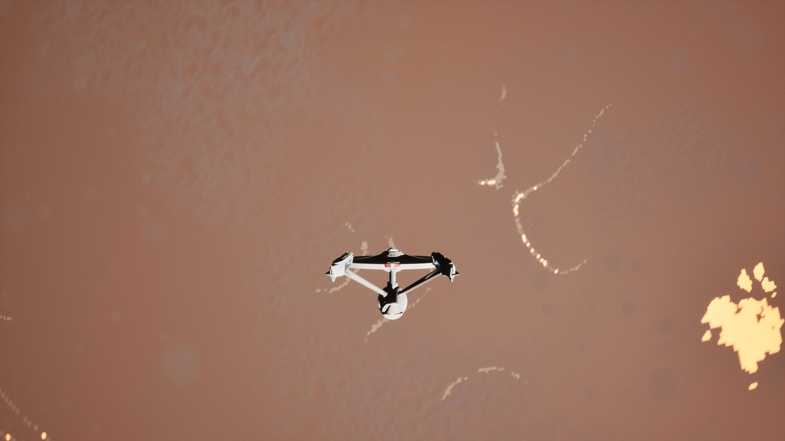

## Moons

Every ringed giant has an icy moon the size of Europa just outside its rings and a hazy moon the size of Titan further out. The icy moons carry lineae, long double-ridged cracks in the crust stained brown along their floors; the hazy moons keep an orange photochemical haze from 30 to 90 km that turns the sky from below. `ship terrain goto linea 300 giant` lands on a crack facing the giant.

https://github.com/user-attachments/assets/ca04ed83-7e29-4f07-84c4-5a8dba818034

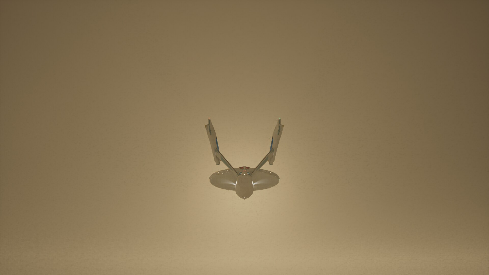 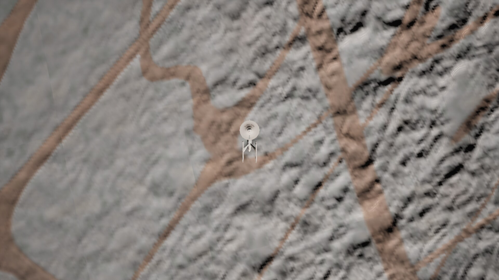

## Nebulae

A nebula is a sphere of gas the ship can fly into: the material ray-marches it from the camera to the far side or the first thing in the way, through domain-warped noise that thins toward a ragged edge, scattering the star's light and the gas's own glow, and the transmittance left over veils whatever lies behind. One a light-second across lies beyond each ringed giant; the nav list knows them.

https://github.com/user-attachments/assets/3abcee09-5a24-4f47-a9fd-c78f1c2a2cbb

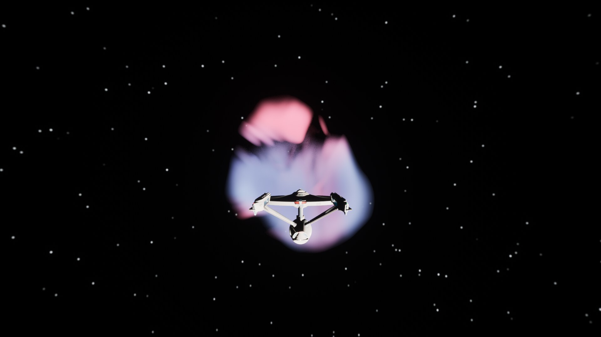 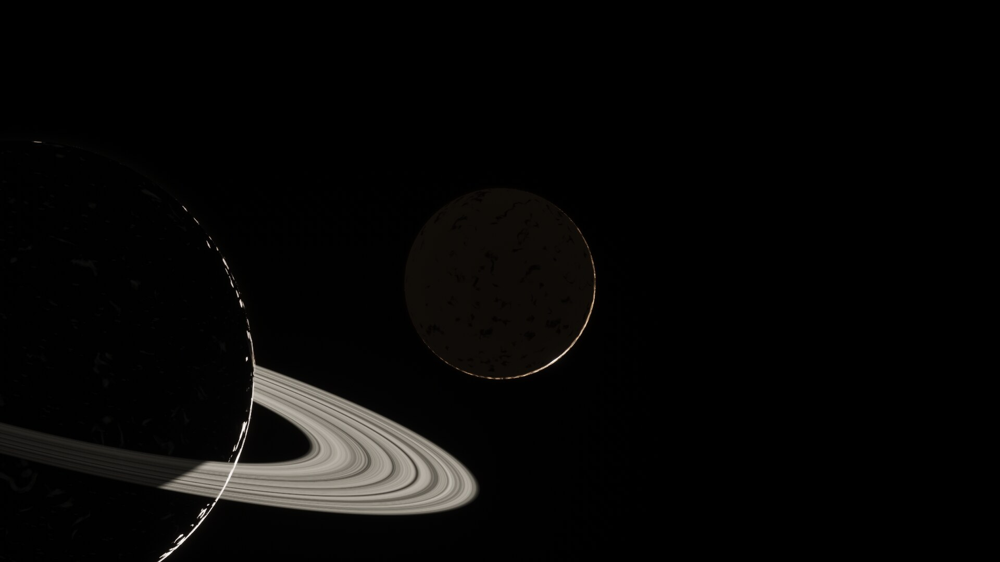

## Ships and stations

A starbase orbits each planet, the deep-space stations (K-7, Regula, Epsilon IX, Vanguard) sit out on their own beyond seven AU, beside the nebulae where there are any, and every one of them has traffic: Constitution, Miranda and Excelsior class ships patrol between stations and warp when they leave. Hulls carry running lights, floodlights and rows of lit windows that show through on the dark side; stations have hub and ring windows, a strobe chase and beacons.

https://github.com/user-attachments/assets/c3715b89-3650-4fff-abd2-6414bca71515

https://github.com/user-attachments/assets/9d4fed35-9918-4979-8f7b-9d059d708661

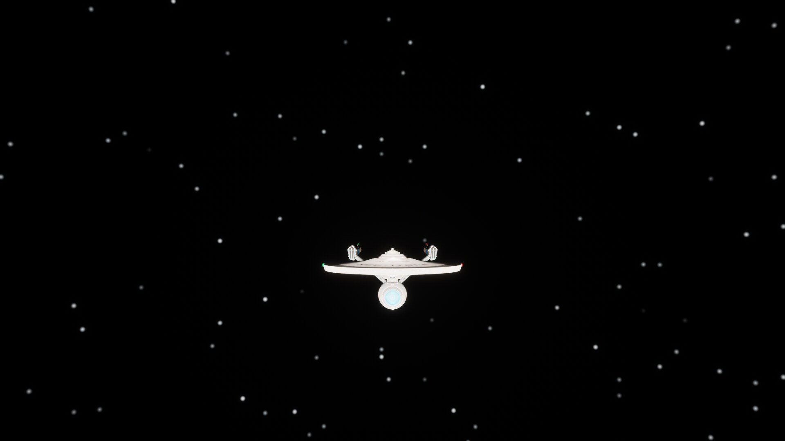 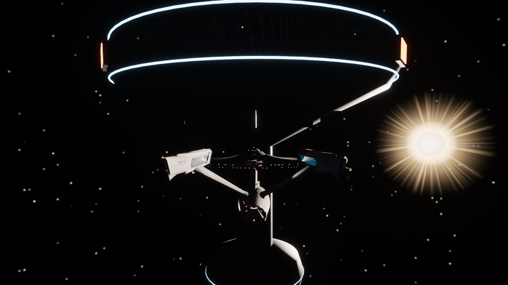

## Shuttlecraft

C launches a shuttle from the fantail bay (the ship has to be out of warp and under 500 m/s), and you fly it in place of the ship: the same controls, a few kilometres a second flat out, no warp, and it answers the throttle in a few seconds whatever the speed, so a tap shows at once and a full stop from flat out takes a dozen seconds. Near a world every craft rides the world's spin, as if the air carried it: the HUD speed is speed over the ground, zero throttle hovers over one spot, and nobody has to match the half kilometre a second an Earth-size surface does to set down. Page Down sinks the shuttle at a few metres a second close to the ground; ease it on below walking pace and it sets down on the slope and turns with the planet; throttle or Page Up lifts it off again. The ship stays parked where you left it, over the same valley, and is the nav target, so the way home is the marker; within 500 m of the bay, C flies the shuttle back in and puts you on the bridge again.

## On foot

F opens the airlock. From the starship you step out onto the top of the saucer in a suit with magnetic boots and a thruster pack; from a landed shuttle you step out of the port door onto the ground. On a world you walk (W A S D, Shift to run) under that world's own gravity, worked out from its size and the density of its kind: a jump takes off at the same speed everywhere, so it is half a metre on an Earth and six on a small moon, and the HUD reads the gravity and the height of the last jump. The terrain is the same height field the shuttle lands on, down to the quarter-metre cells, so slopes, ledges and canyon walls are real; anything steeper than fifty degrees stops you. On the hull the boots hold wherever they touch: the saucer top, up the bridge module, round the rim and on to its side, down a ledge, and across to a nacelle; Space pushes off, and the pack flies with the ship's thruster keys (W S fore and aft, A D sideways, Page Up and Page Down up and down, Q E roll, the mouse pitching and yawing, X killing the relative motion). Armed boots take the hull again on contact; B switches them off to float free. Near a world you fall when nothing holds you, and the pack's two and a half metres per second squared will out-climb a moon's gravity but not a planet's. Everyone rides the world's spin as the craft do, so a parked ship and a person on its hull stay together. V swaps the chase view for the helmet. F boards again from anywhere on the craft's hull or within ten metres of the hatch; the craft sits where you left it and is the nav target while you are out.

https://github.com/user-attachments/assets/060101b3-9c50-4922-9e4b-0001edd3ebba

## Science

Every world, star, station, ship, belt and nebula can be scanned into a science log. Pick it as the nav target (or lock it with T), close to sensor range, which the HUD shows, and press Enter: the scan runs for a few seconds while the target stays ahead of the ship, then the readings go on screen and into the log with the points they earned. Planets report their class, size, gravity, day, orbit and zone, atmosphere, oceans, ice, rings, moons and city lights; stars their spectral class and planets; stations and ships their type and condition. Some scans turn up a discovery, dilithium, ruins, life, a protostar, worth extra. Points add up to a Starfleet Science rating, from Field Researcher to Daystrom Fellow, and scanning every star and planet of a system completes its survey for a bonus. Land the shuttle and Enter surveys the ground instead: elevation, slope, a core sample and the air, a record of its own on top of the orbital scan. The log is saved between sessions; `/` opens the catalogue.

## Combat

Phasers, photon torpedoes, shields with a visible bubble, hull damage, a tractor beam and a Borg cube that shoots back. Lock the nearest target and fire; the HUD tracks shields and hull. On the Enterprise-A the phaser banks fire from the emitters painted on the hull, twin beams from each dual bank, and the RCS plumes leave its painted thruster ports; both come from one scan of the hull textures (`tools/rcs_ports/find_ports.py`).

https://github.com/user-attachments/assets/77b4a194-d3a0-4cb2-a4f4-148228e0b8bb

## Command

The ship is a crewed machine. Seven systems carry their own integrity and power share: shields, phasers, torpedo launchers, warp drive, impulse engines, sensors and life support. A hit that gets through the shields breaks one of them, and a broken system shows: shield emitters at half mean a half-size grid that recharges slowly, phaser banks at a quarter fire a quarter of the beam, a warp drive below seventy per cent cannot hold its top factor, dead impulse engines crawl. The senior staff are named and report to the captain: Lt. Cmdr. Rhys Dahl in engineering calls out what broke and when the damage-control team has it back, Lt. Sorek at tactical calls alerts and locks. Rather than sliders the captain gives orders. `,` opens the engineering board with every system's integrity bar and power, a button to divert power to it (that system to 150 %, the rest sharing the remainder) and one to send the damage-control team there (or leave it to the chief, who takes the worst first and patches the hull when nothing else is broken), and the bridge log of everything the crew said. `.` opens tactical: alert state, shields, phasers, tubes, the locked target and the contacts in range with bearing, kind and hull, and the orders to lock, clear and fire. 5, 6 and 7 are condition green, yellow alert and red alert: yellow turns the HUD amber and warms the bridge lighting; red turns both red, pulses the bridge lights, stiffens the shields and gets the crew bracing, so a hit breaks less. Every order has a console form too: `ship order alert red`, `ship order power shields`, `ship order repair warp`, `ship order report`.

## The bridge

The Star Trek VI bridge is built from code in Blender (`blender/bridge-st6`) and imported as one mesh with its Okudagram screens bound to live readouts. From the captain's chair the viewscreen shows the real view ahead; the crew figures are placeholders for now.

https://github.com/user-attachments/assets/28b77f79-c31d-487a-ac32-dce1ff09c396

## LCARS panels

Escape opens the main computer: an Okudagram panel built with the engine's CommonUI plugin, elbows, pills and all, with the ship's status and the way to the other panels. M opens stellar cartography, a full-screen star chart of the system: drag to pan, wheel to zoom about the cursor, right-drag to tilt and turn; click a body or one of the other systems listed at the top right to select it, double-click or Set Course to make it the nav target, Autopilot to go there. The nav filter (I, or the drop-down at the chart's top right) hides kinds from the map and from the click alike, so a world is easy to pick out from under a nebula. The chart has three scopes, on tabs above the map or the 1, 2 and 3 keys: Sector shows the neighbouring suns about the current star with their distances, in their own colours and with stems to the plane; System is the planets, belt and traffic about the star; Local centres one world, the selected planet (or a selected moon's primary, or the one nearest the ship), drawn at true size with its moons on their orbits and whatever else lies within four hundred radii. The grid rings are labelled in km, AU or light-years to suit. The chart marks catalogued bodies with a tick and shows a scanned body's readings when you hover it. `/` opens the science log as a window with every record and its discoveries, H the controls list. Panels take the mouse and pause the ship's controls while they are up; Escape or the gamepad's B closes the one on top. Settings, from the main computer, picks the panels' typeface, the engine's Roboto or Antonio, the condensed face in the spirit of the real displays, and flips the HUD overlays; the typeface is kept between sessions. Where the on-screen key list used to be there is now one line of hints, and the minimap's toggle lives in the chart's sidebar.

## Controls

Mouse or the left stick steers; H opens the controls panel with the full key list.

| | |
|---|---|
| W / S, mouse wheel | throttle; 1 to 4 set quarter to full impulse, X all stop, Z reverse |
| J, [ and ] | warp on/off, warp factor down/up (past 9.9 is transwarp) |
| L, K | next nav target, clear it |
| I | nav filter: all, stars, worlds, moons, stations, ships, nebulae and belts (applies to the markers, the map and L; in the chart it is also a drop-down at the top right) |
| P | autopilot to the nav target: a warp leg when it is far, an impulse approach when it is near; P again disengages |
| O | orbit hold round the nav target or the nearest body |
| C | shuttlecraft: launch from the bay; aboard it, dock when within 500 m of the bay |
| F | airlock: step out onto the hull, or out of a landed shuttle; on foot, board again (W A S D walk, Shift run, Space jump or push off, B boots, Page Up / Down and X the pack) |
| Enter | scan the locked target, else the nav target; aboard a landed shuttle, survey the ground |
| Escape | main computer: status, star chart, science log, controls, quit |
| M | stellar cartography: the full star chart, course setting and autopilot (1, 2, 3 pick Sector, System or Local) |
| / | science log: every scan on record, points, rating and the system survey |
| , . | engineering board (power and repairs), tactical board (alert, weapons, contacts) |
| 5 6 7 | condition green, yellow alert, red alert |
| H | controls panel |
| T, Y | lock / clear a weapons target; left mouse phasers, Space or G torpedo, B tractor beam |
| V, R, right mouse | cycle camera (chase, bridge, cinematic, front, port, starboard, top, bottom), reset, free look |
| N, Tab, U | nav markers, HUD, classic / relativistic warp view |
| Page Up / Down, arrows | vertical and RCS thrusters |

The nav target is the pulsing ring with four ticks (white to blue), the weapons lock the orange corner box.

Everything else is a console command: press the backtick key (`` ` ``) to open the console and type `ship` followed by the command. `ship help` lists them; the ones used in this README are `ship nav target <name>`, `ship nav filter <kind>`, `ship autopilot warp|impulse|off`, `ship warpvis classic|real`, `ship camera <view>`, `ship systems`, `ship hover <m> [canyon]`, `ship terrain goto <feature> <altitude m>`, `ship cscale <0..1>` and `ship shipwarp` (sends the nearest patrol ship to warp).

## Credits

The Enterprise hull flown in the space test is the one paid asset in the project: "U.S.S. Enterprise NCC-1701-A" (https://skfb.ly/6RsXJ) by Major Stress is licensed under Creative Commons Attribution (http://creativecommons.org/licenses/by/4.0/). Everything else is generated by the project's own scripts and code.

The Star Trek VI bridge set in `blender/bridge-st6` was modelled from scratch using Donny Versiga's renders of the 2293 Enterprise-A bridge as reference, view for view (https://www.artstation.com/artwork/YeNkG3). None of his files are used; his work set the layout, proportions and look that the set is measured against. Thank you, Donny.

The LCARS panels' condensed typeface is Antonio by Vernon Adams and the Antonio Project Authors, under the SIL Open Font License 1.1 (`unreal/Content/UI/Fonts/OFL.txt`).
