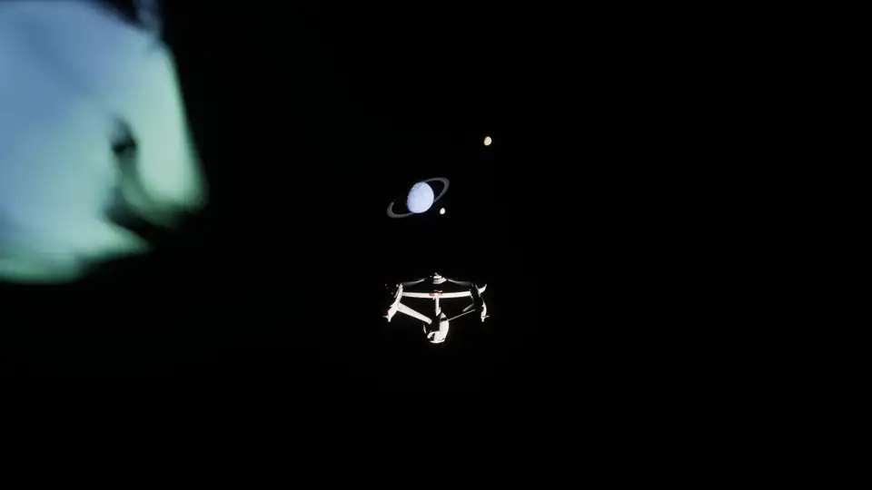
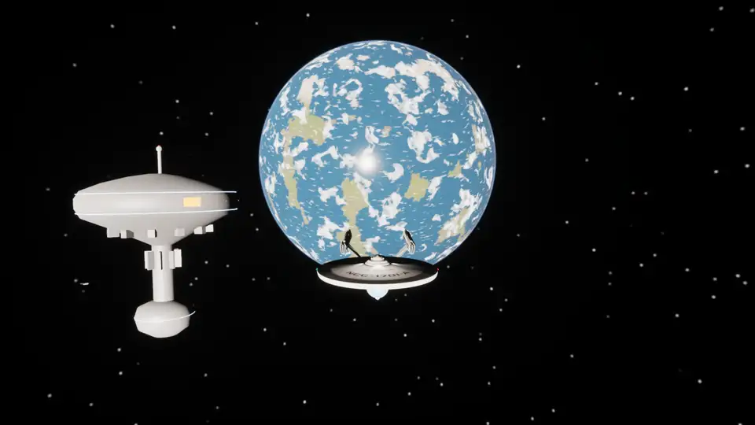
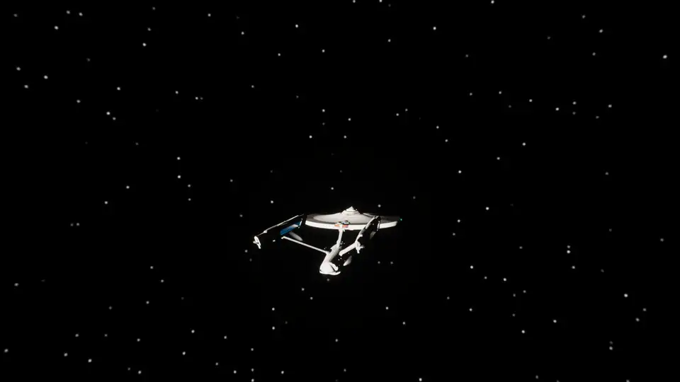
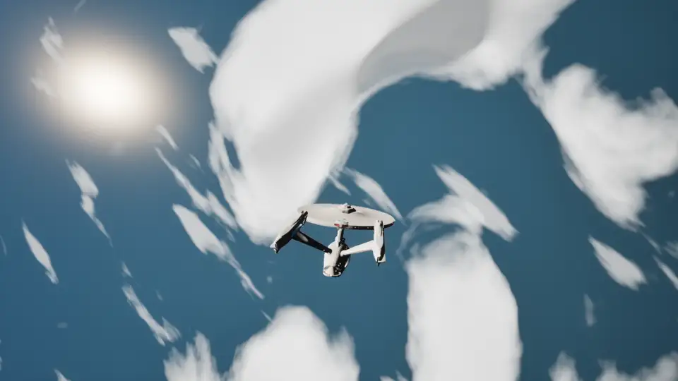
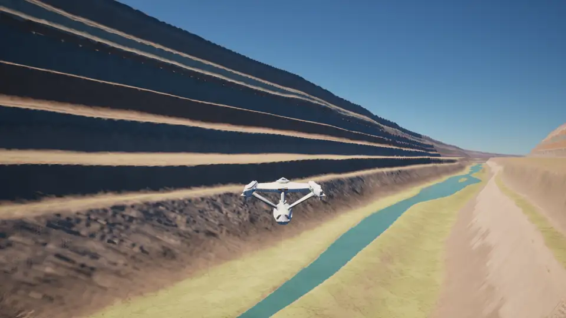
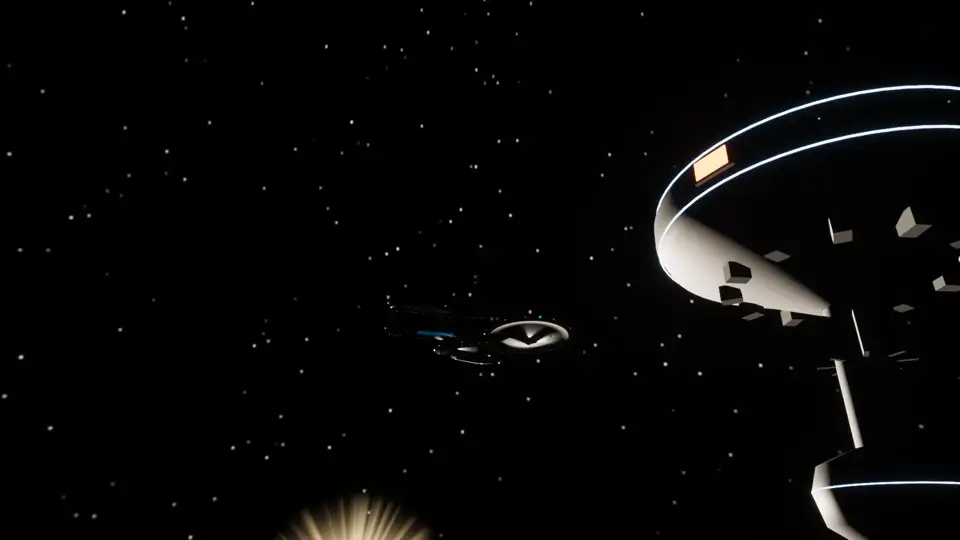
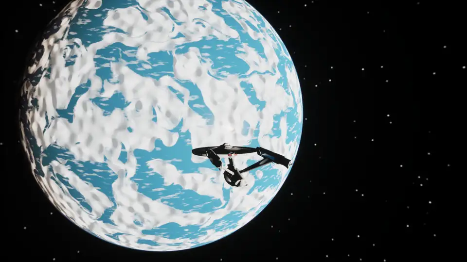
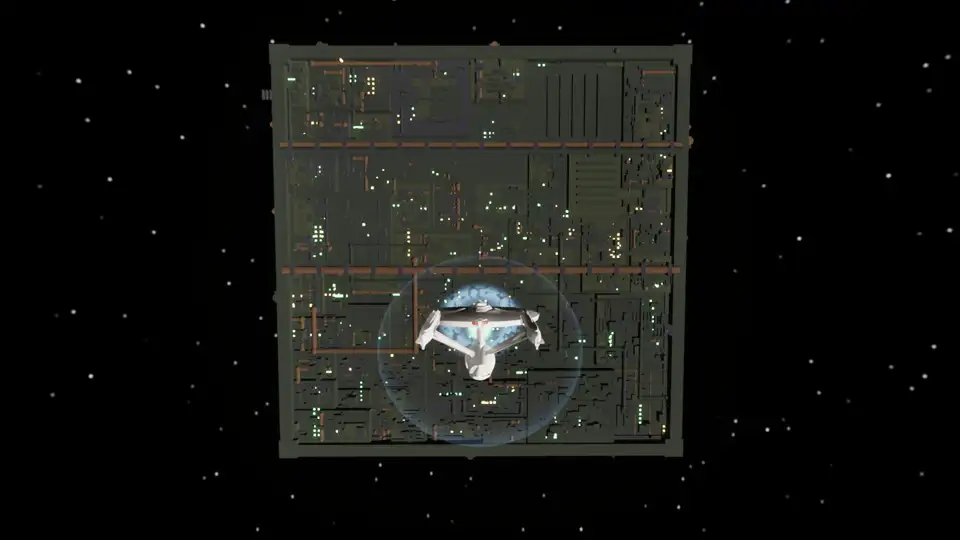
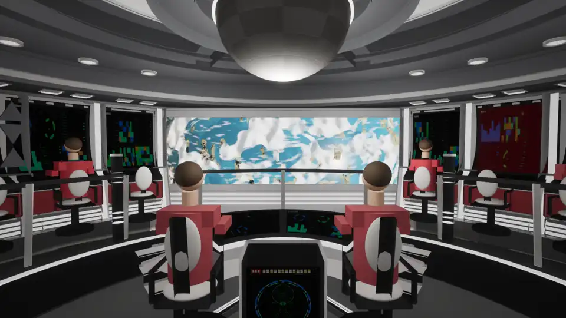

# slonk-the-game

A flyable, life-size Star Trek solar system in Unreal Engine 5.8. You fly a kinematic Enterprise with impulse and warp drive through a procedurally generated star system at real scale: planets with terrain, atmospheres, clouds and rings, an asteroid belt, spinning space stations, patrolling starships that warp between them, a Borg cube, and combat with shields, phasers, torpedoes and a tractor beam. A floating origin keeps AU-scale distances precise, and the Star Trek VI bridge set gives a first-person view from the captain's chair.

The project lives in `unreal/` (open `Slonk.uproject` in UE 5.8, build the `SlonkEditor` target, open the `SpaceTest` map and press Play). C++ is in `unreal/Source/Slonk`; materials and the map are generated assets under `unreal/Content/Slonk`. The clips below are animated WebP files in `docs/media`, captured in play.

## Scale

The system is real size. Planets are thousands of kilometres across, orbits are tenths of an AU to tens of AU apart, and the ship is 305 m long, so nothing is faked with a skybox: the planet behind the station below really is 23,000 km away. Full impulse is a quarter of the speed of light, with a throttle curve that still gives km/s precision near a station.

Looking aft from beside Starbase 11: a slow drift past the station, then full impulse. The station is gone in a blink and the Earth-like world behind it shrinks to a coin in ten seconds.

## Impulse and warp

Warp speed follows the show's curve (warp 1 is light speed, warp 3 is 39 c), so a hop between orbits takes seconds and crossing the system takes a minute. Two warp looks are built in, switched with `warpvis classic` and `warpvis real`: the classic streak-and-flash, and a relativistic view with aberration, Doppler shift and retarded-time imaging.

## Planets

Every world is generated at real scale from a seed. The height field is computed in double precision on the CPU in two stages, the way Outerra layers fractal detail over its elevation data: a structure stage (domain-warped continents, ridged mountain ranges, canyons cut into uplifted tablelands with fluted, stratified walls and a river down the inner gorge, craters on the airless worlds) down to 200 m, and a refinement stage that synthesises what lies below it from the structure's local slope (fractured rock on cliffs, talus and boulders beneath them, hummocky soil on the flats) down to 25 cm. Both are deterministic functions of position, so nothing is stored and every visit is the same place. The surface is drawn through a cube-sphere quadtree of mesh chunks that splits toward the camera from six root chunks in orbit down to those 25 cm cells on the ground, so the same surface serves the view from space and a flight along a canyon floor. Atmospheres are volumetric with real scale heights, planets turn at real day lengths, relief is in real proportion, and the gas giants keep a shader-shaded sphere with cloud bands and rings. Orbit hold keeps a chosen altitude while you look around; `hover <m>` follows the terrain (`hover <m> canyon` also steers along the canyon), and `terrain goto river 200 along` parks the ship over the river in the deepest canyon of the nearest world, nose along it.

Down the inner gorge of a canyon on the Earth-like world at 250 m/s, 150 m above the floor. The walls are a stack of strata of hashed thickness and hardness: hard layers stand as cliffs, soft ones slump into scree, and the benches wander along the canyon. The ground is dressed with four tileable texture sets (bedded cliff, talus, desert soil, scrub) baked in Blender from procedural shaders on a 4-D torus so they wrap, packed to colour + height and normal + occlusion + roughness, and chosen per pixel by slope, rock and moisture. They are laid down in 20 m hashed cells of a planet-local lattice, each with its own heading in a frame tied to the ground and projected triplanar within it, so 5 m tiles never line up into a quilt and the beds stay horizontal on the cliffs; the sets modulate the procedural colour rather than replace it. `tools/planet_materials/bake_terrain_textures.py` bakes them and `import_terrain_textures.py` imports them headless.

 
 
 
 

## Ships and stations

Every station orbits a planet and every planet has traffic: Constitution, Miranda and Excelsior class ships patrol between stations and warp when they leave. Hulls carry running lights, floodlights and rows of lit windows that show through on the dark side; stations have hub and ring windows, a strobe chase and beacons.

 
 

## Combat

Phasers, photon torpedoes, shields with a visible bubble, hull damage, a tractor beam and a Borg cube that shoots back. Lock the nearest target and fire; the HUD tracks shields and hull.

## The bridge

The Star Trek VI bridge is built from code in Blender (`blender/bridge-st6`) and imported as one mesh with its Okudagram screens bound to live readouts. From the captain's chair the viewscreen shows the real view ahead; the crew figures are placeholders for now.

## Warp, the relativistic view

In the relativistic view a ship moving faster than light is seen as several images. Light from the point of the track nearest you arrives first, and the images then run outward along the track in both directions from that point. The visual light speed is scaled down (`cscale`) so the effects span seconds. Our own jump, chase camera, with the star field crowding forward and blue-shifting:

https://github.com/user-attachments/assets/0eb46304-8d26-4cdf-99b2-8ab644f1f65a

Head-on arrival of another ship, real time. It pops into view at its arrival point first, and an after-image then runs backward up the track, red-shifted and shrinking, until it replaces the old pre-departure image:

https://github.com/user-attachments/assets/858b2e8a-76b2-4eaf-92c0-db17e63479dd

Beside the track, 4x slow motion. A copy appears mid-track and splits in two: one runs back to the departure point and merges with the old image, the other slides on to the destination and becomes the live ship:

https://github.com/user-attachments/assets/ee582208-d1a2-4239-a63b-071e58248faf

 

## Credits

The Enterprise hull flown in the space test is the one paid asset in the project: "U.S.S. Enterprise NCC-1701-A" (https://skfb.ly/6RsXJ) by Major Stress is licensed under Creative Commons Attribution (http://creativecommons.org/licenses/by/4.0/). Everything else is generated by the project's own scripts and code.

The Star Trek VI bridge set in `blender/bridge-st6` was modelled from scratch using Donny Versiga's renders of the 2293 Enterprise-A bridge as reference, view for view (https://www.artstation.com/artwork/YeNkG3). None of his files are used; his work set the layout, proportions and look that the set is measured against. Thank you, Donny.
